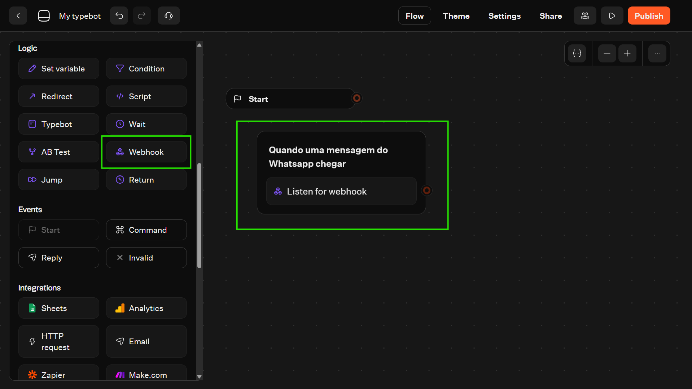

# Integração ZapHook + Typebot

<figure><figcaption></figcaption></figure>

Este guia ensina como conectar o ZapHook ao Typebot utilizando o Bloco de Webhook para receber dados do WhatsApp diretamente no seu fluxo.

Nosso objetivo é fazer com que uma mensagem recebida no WhatsApp (via ZapHook) dispare ou destrave um fluxo no Typebot em ambiente de teste.

### Pré-requisitos

1. Uma conta ativa no ZapHook com um Canal (Channel) de WhatsApp configurado<sup>1</sup>.
2. Uma conta no [Typebot](https://typebot.io/) com um fluxo criado.
3. Um token de API do Typebot (necessário para autenticação).

***

### Passo 1: Gerar o Token de API no Typebot

<figure><figcaption></figcaption></figure>

O Typebot exige autenticação para aceitar requisições em seus webhooks.

1. Acesse seu dashboard no Typebot.
2. Clique em Settings & Members > My account.
3. Na seção "API tokens", clique em Create.
4. Dê um nome ao token (ex: `ZapHook Integration`) e clique em Create token.
5. Copie o token. Você precisará dele na configuração do ZapHook.

> Nota: O cabeçalho de autenticação deve seguir o formato `Authorization: Bearer <token>` na requisição.

***

### Passo 2: Criar o fluxo de recepção no Typebot

<figure><figcaption></figcaption></figure>

Antes de gerar a URL, precisamos preparar o Typebot para "ficar ouvindo" e aguardar a chegada dos dados do ZapHook.

1. No editor do seu Typebot, localize a seção Logic na barra lateral esquerda.
2. Arraste o bloco Webhook para a área de trabalho.
3. Conecte a saída do bloco Start diretamente a este novo bloco de Webhook.
4. (Opcional) Renomeie o grupo para algo como _"Quando uma mensagem do Whatsapp chegar"_ para facilitar a organização.

> Atenção: Certifique-se de usar o bloco Webhook (roxo, encontrado em _Logic_) e não o bloco _HTTP Request_.

* Webhook (Logic): Faz o bot pausar e esperar até receber dados de fora (o que queremos que o ZapHook faça).
* HTTP Request: Faz o bot _enviar_ dados ativamente (não é o caso agora).

Agora que o bot está pronto para ouvir, vamos pegar o endereço correto no próximo passo.

### Passo 3: Obter a URL de Teste do Typebot

Para testar a integração sem publicar o bot, utilizaremos a URL de execução de teste do bloco.

1. No editor do Typebot, adicione um Webhook block (Bloco de Webhook) onde você deseja receber os dados.
2.  A estrutura da URL de teste para Web é:

    https://typebot.io/api/v1/typebots/{typebotId}/blocks/{blockId}/web/executeTestWebhook
3. Copie esta URL específica do bloco que você criou.

> Importante: O Typebot diferencia URLs de teste (Web/WhatsApp) e URLs de Produção. Neste guia, usaremos a URL de teste Web para validar o recebimento do JSON.

***

### Passo 3: Criar o Destino no ZapHook

<figure><figcaption></figcaption></figure>

Agora, vamos configurar o ZapHook para enviar os dados para essa URL.

1. Acesse o painel do ZapHook e vá para a aba Destinations (Destinos)<sup>2</sup>.
2. Clique em Create Destination.
3. Configurações Básicas (Tab Basic): <sup>3</sup>
   * Channel: Selecione o canal do WhatsApp que receberá as mensagens.
   * Name: Ex: "Typebot Test".
   * Endpoint URL: Cole a URL de teste que você copiou do Typebot no Passo 2.
   * HTTP Method: Mantenha como `POST`<sup>4</sup>.
4.  Configuração de Autenticação (Tab Headers): 5

    O Typebot rejeitará a chamada se não estiver autenticada. Adicione o seguinte Header:

    * Key: `Authorization`
    * Value: `Bearer SEU_TOKEN_AQUI` (Cole o token gerado no Passo 1).
5. Clique em Save.

***

### Passo 4: Mapeamento de Dados&#x20;

<figure><figcaption></figcaption></figure>

Nesta etapa, vamos usar o editor visual do ZapHook para formatar os dados exatamente como o Typebot espera receber. Ao invés de lidar com o JSON complexo e aninhado da Meta, você vai criar um pacote de dados simples e limpo.

1. Na janela de criação do Destino, clique na aba Mapeamento de Campos.
2. No editor de texto à esquerda (JSON Field Mapping), apague qualquer conteúdo e cole a estrutura sugerida abaixo. Este é um formato simplificado ideal para começar:

```
{
  "sender_phone": " ",
  "sender_name": " ",
  "message_text": " "
}
```

Agora, utilize a lista Available Placeholders à direita para preencher os valores entre as aspas:

* Posicione o cursor dentro das aspas de `"sender_phone": " "`.
* Arraste (ou clique em) Telefone do remetente na lista lateral.
* Repita para `"sender_name"` arrastando Nome do contato.
* Repita para `"message_text"` arrastando Texto da mensagem.

_O resultado final no editor deve parecer com isso:_

```
{
  "sender_phone": "{{entry[0].changes[0].value.metadata.display_phone_number}}",
  "sender_name": "{{entry[0].changes[0].value.contacts[0].profile.name}}",
  "message_text": "{{entry[0].changes[0].value.messages[0].text.body}}"
}
```

3. Clique em Create Destination para salvar.

***

### Passo 5: Configurando as Variáveis no Typebot

Agora que definimos o formato do envio, precisamos dizer ao Typebot quais variáveis salvar.

1. Volte ao seu fluxo no Typebot.
2. Clique no bloco Webhook que você criou.
3. Na seção Save variables, mapeie os campos do JSON que criamos acima para as variáveis do seu bot:
   * Field: `sender_phone` → Variable: Selecione ou crie `Telefone` (ou `Phone`).
   * Field: `sender_name` → Variable: Selecione ou crie `Nome` (ou `Name`).
   * Field: `message_text` → Variable: Selecione ou crie `Mensagem` (ou `Body`).

Desta forma, assim que a mensagem chegar, o Typebot extrai apenas as informações úteis e descarta o resto.

### Passo 5: Testando a Integração

1. No Typebot, clique em "Test" no Webhook block para deixá-lo aguardando a chamada ("Listening").
2. Envie uma mensagem de WhatsApp para o número conectado ao seu Canal no ZapHook.
3. O ZapHook receberá a mensagem instantaneamente, processará e enviará para a URL do Typebot.
4. Verifique no editor do Typebot: o bloco deve acusar "Success" e mostrar os dados recebidos (Telefone, Nome, Mensagem).

<figure><figcaption></figcaption></figure>

#### Solução de Problemas

* Erro 401 (Unauthorized): Verifique se você colou o Token corretamente na aba Headers do destino no ZapHook<sup>7</sup>.
* Timeouts: O Webhook block do Typebot serve para _pausar e esperar_. Se você quer apenas disparar uma ação e continuar, ou se o fluxo travou, verifique se o Typebot estava em modo de "Test/Listening" no momento do envio.
