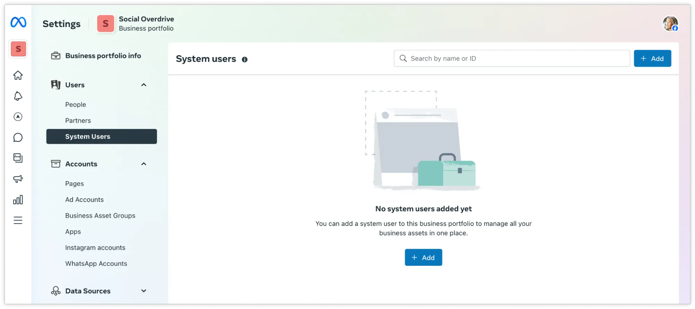

# Como gerar o Token de Acesso (System User) para o ZapHook

Para que o ZapHook possa gerenciar seus webhooks, fazer download de mídias recebidas e garantir a estabilidade da sua conexão com o WhatsApp Oficial (WABA), é necessário gerar um token de acesso permanente.

Diferente de tokens temporários (que expiram em 24h), utilizaremos um Usuário de Sistema. Isso garante que sua operação não pare caso um funcionário troque de senha ou saia da empresa.

#### Pré-requisitos

* Ser administrador do Gerenciador de Negócios (Meta Business Suite) da sua empresa.
* Ter um Aplicativo (App) criado no painel de desenvolvedores da Meta vinculado a este negócio.

***

#### Passo 1: Acessar Usuários do Sistema

1. Acesse as Configurações do Negócio da Meta: [business.facebook.com/settings](https://business.facebook.com/settings)
2. No menu lateral esquerdo, vá em Usuários > Usuários do sistema.

<figure><figcaption></figcaption></figure>

#### Passo 2: Criar o Usuário para o ZapHook

1. Clique no botão azul + Adicionar.
2. Preencha os dados:
   * Nome do usuário: Recomendamos usar `ZapHook Integration` ou `API ZapHook`.
   * Função do usuário: Selecione Administrador.
3. Clique em Criar usuário do sistema.

<figure><figcaption></figcaption></figure>

> Nota: Se este for o primeiro usuário de sistema que você cria, a Meta pode pedir que você aceite os termos de responsabilidade. Aceite para prosseguir.

#### Passo 3: Conectar seu App (Ativos)

<figure><figcaption></figcaption></figure>

O usuário criado precisa de permissão para mexer no seu App do WhatsApp.

1. Com o usuário `ZapHook Integration` selecionado na lista, clique em Adicionar ativos.
2. Na janela que abrir:
   * No menu lateral, clique em Apps (ou Aplicativos).
   * Selecione o seu App do WhatsApp.
   * No canto direito, ative a chave Gerenciar app (Controle total).
3. Clique em Salvar alterações.

<figure><figcaption></figcaption></figure>

#### Passo 4: Gerar o Token Permanente

<figure><figcaption></figcaption></figure>

Agora vamos gerar a chave que você colocará no ZapHook.

1. Ainda na tela do usuário de sistema, clique no botão Gerar novo token.
2. Selecione o App que você vinculou no passo anterior.
3. Validade do Token: Selecione Nunca expira (ou _Never_).
   * _Importante: Se você colocar 60 dias, sua automação parará de funcionar após esse período._
4.  Permissões (Escopos):

    Para que o ZapHook funcione corretamente, marque exatamente as 3 opções abaixo na lista:

    * `business_management`
    * `whatsapp_business_management`
    * `whatsapp_business_messaging`
5. Clique no botão Gerar token.

<figure><figcaption></figcaption></figure>

#### Passo 5: Copiar e Salvar

O token aparecerá na sua tela (uma sequência longa de letras e números).

1. Copie este código imediatamente.
2. Vá até o painel do ZapHook.
3. Cole o código no campo Token de Acesso.

> Atenção: Por segurança, a Meta não mostrará este código novamente. Se você perdê-lo, terá que gerar um novo token e atualizar no ZapHook.

***

#### Dicas de Solução de Problemas

*   O botão "Gerar novo token" está desabilitado?

    Verifique se você completou o Passo 3. O usuário de sistema só pode gerar tokens se tiver um App atribuído a ele.
*   Erro de Permissão (200) no ZapHook?

    Certifique-se de que o usuário de sistema criado também tem acesso à Conta do WhatsApp (WABA). Se necessário, vá em Contas > Contas do WhatsApp, clique em Adicionar Pessoas e adicione o usuário de sistema que você criou.

### Referências&#x20;

* [Meta for Developers: Adquirir Token de Acesso usando Usuário do Sistema](https://developers.facebook.com/docs/whatsapp/business-management-api/get-started#1--acquire-an-access-token-using-a-system-user-or-facebook-login)

