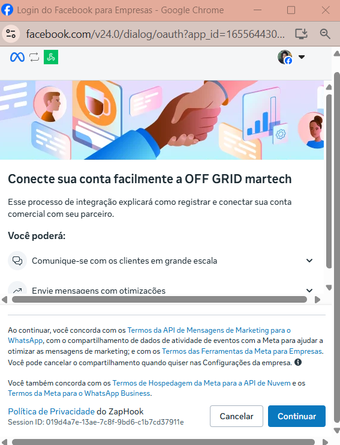

# Conectando seu WhatsApp via coexistência no ZapHook (Guia de integração)

### O que é a Coexistência?

A Coexistência é um modo oficial da Meta que permite que:

* Você mantenha o aplicativo WhatsApp Business ativo no celular (uso diário, atendimento manual, etc.)
* Ao mesmo tempo, a sua conta também fica conectada à Plataforma/Cloud API, permitindo integrações e automações via ZapHook.

#### O que muda na prática

* Sincronização inicial: pode haver importação de contatos e histórico de conversas (últimos 6 meses), conforme opção exibida no fluxo. 
* Espelhamento: novas mensagens e eventos podem ser recebidos pela integração (webhooks), enquanto você segue respondendo pelo app. 
* Regra das 24 horas: a janela de atendimento de 24h continua valendo para mensagens enviadas pela API. Mensagens enviadas manualmente pelo app não criam nem estendem essa janela para a API.

***

### Pré-requisitos (antes de começar)

Garanta que você possui:

1. Um número com WhatsApp Business ativo no celular (não WhatsApp Messenger).
2. Acesso à conta do Meta Business Manager (portfólio empresarial) da empresa.
3. Permissão para conectar ativos e autorizar integrações.
4. App WhatsApp Business atualizado (recomendado manter sempre na última versão disponível).

⚠️ Observação importante: dependendo do seu cenário, a Meta pode solicitar etapas de validação no próprio app (ex.: confirmação/compartilhamento e importação de dados).

### Etapa 1 — Iniciar a conexão no ZapHook

1. Acesse seu painel do ZapHook.
2. Vá em Channels (Canais).
3. Crie um novo Channel ou selecione um Channel existente.
4. Clique em Conectar WhatsApp Business.

✅ Nesse momento, o ZapHook abre um modal oficial da Meta (Embedded Signup) para você concluir a conexão com segurança.

#### 2.1 Boas-vindas / Início do processo

Você verá uma tela de introdução indicando que você está prestes a conectar sua conta a um parceiro/infraestrutura.\
No seu caso, pode aparecer a referência a OFF GRID martech (infraestrutura parceira do ZapHook).

* Clique em Continuar para iniciar.

💡 Dica: deixe claro na sua documentação que ZapHook e OFF GRID martech fazem parte do mesmo fluxo de integração/parceria técnica, para evitar confusão do cliente.

### 2.3 Selecionar ativos de negócios

.png>)

Nesta etapa, a Meta pede para escolher quais ativos serão compartilhados com o ZapHook no processo de integração.

Você normalmente verá dois campos principais:

1. Portfólio empresarial (Business Manager): selecione a conta da sua empresa.
2. Conta do WhatsApp Business: selecione a opção para conectar um app do WhatsApp Business.

Depois, clique em Avançar.

### 2.4 Inserir o número do WhatsApp Business

Agora você deve informar o número que já está em uso no app WhatsApp Business.

.png>).png>)

1. Selecione o país (ex.: Brasil +55)
2. Digite seu número de telefone (o mesmo que está no WhatsApp Business)

Clique em Avançar.

#### Quando o número já está no app (Coexistência)

Como o número já está vinculado ao app, a Meta reconhece isso e apresenta uma opção indicando que você pode conectar o app existente (coexistência) e compartilhar o acesso.

Você verá uma mensagem do tipo:

* “Conecte seu app WhatsApp Business existente”
* “Compartilhamento de acesso”
* Informação de que contatos, conversas e histórico podem ser compartilhados conforme o fluxo

Clique em Avançar para continuar.

### 2.5 Importar contatos e histórico (QR Code / confirmação no app)

.png>)

Esta é a etapa mais importante para a Coexistência.

A Meta pode solicitar permissão para importar/sincronizar contatos e histórico de conversas (por exemplo, dos últimos 6 meses) e exibir um QR Code no modal.

#### O que fazer

1. Abra o WhatsApp Business no seu celular.
2. Siga a instrução exibida pela Meta, que normalmente inclui:
3. localizar uma notificação/mensagem da conta oficial relacionada ao processo, ou
4. usar o app para ler o QR Code mostrado na tela
5. No celular, toque em Conectar e confirme o compartilhamento/integração quando solicitado.

⚠️ Nota de estabilidade: mantenha o WhatsApp Business atualizado para reduzir falhas de sincronização.

### 2.6 Confirmar dados do perfil (nome e fuso horário)

Depois da confirmação no celular, o modal pede para revisar dados da conta:

* Nome da conta do WhatsApp Business
* Fuso horário (ex.: America/Sao Paulo)

Ajuste se necessário e clique em Avançar.

### 2.7 Revisar permissões / Confirmar acesso

.png>)

Nesta tela, a Meta mostra exatamente o que o ZapHook poderá acessar, por exemplo:

* Gerenciar contas e conversas do WhatsApp
* Acessar conversas no WhatsApp
* Registrar eventos comerciais (quando aplicável)

Para autorizar a integração, clique em Confirmar.

### 2.8 Conclusão do processo (“Conta conectada…”)

.png>).png>)

Ao final, você verá uma tela informando que sua conta foi conectada ao parceiro (ex.: OFF GRID martech).

Geralmente aparecem duas opções:

* Adicionar forma de pagamento (quando aplicável ao faturamento/recursos da Meta)
* Concluir

Clique em Concluir para encerrar o modal e voltar ao ZapHook.

## Etapa 3 — Retorno ao ZapHook e sincronização inicial

Após clicar em Concluir:

1. O modal da Meta fecha automaticamente.
2. Você retorna ao painel do ZapHook.
3. O ZapHook exibe uma mensagem de Sucesso, indicando que a integração foi estabelecida.

#### O que acontece depois

* O ZapHook inicia a etapa de sincronização inicial (quando aplicável).
* O tempo pode variar conforme o volume de conversas/contatos e a conexão.
* Durante esse período, é recomendável manter o app WhatsApp Business acessível no celular e a internet estável.

## Informações importantes (regras e limitações)

### Janela de atendimento de 24 horas (Cloud API)

* A restrição de 24 horas se aplica às mensagens enviadas pela API.
* Mensagens enviadas manualmente pelo app WhatsApp Business:
* não abrem
* não estendem
* não alteram a janela de atendimento usada pela API

### Mensagens e cobrança

* Mensagens enviadas pelo app podem seguir as regras do próprio aplicativo.
* Mensagens enviadas pela API podem estar sujeitas a cobrança conforme regras da Meta.

### Dispositivos conectados (WhatsApp Web / apps adicionais)

Ao ativar a coexistência:

* alguns dispositivos adicionais (como WhatsApp Web ou apps complementares) podem ser desvinculados
* pode ser necessário vincular novamente depois pelo dispositivo principal

## Solução de problemas (rápido)

### “Conectando sua conta…” não avança

* Clique em Tentar novamente (se disponível)
* Verifique se você está logado na conta correta do Facebook/Business Manager no navegador
* Tente em janela anônima ou outro navegador (caso cookies/sessão estejam interferindo)

### QR Code não funciona ou não aparece

* Atualize o WhatsApp Business no celular
* Garanta permissão de câmera e conexão estável
* Feche e reabra o modal (quando possível) e repita a etapa

### Não encontro meu Portfólio Empresarial

* Você pode não ter permissão no Business Manager correto
* Peça para um administrador conceder acesso/nível adequado para integração de ativos

### Checklist final (o que confirma que deu certo)

* Consegui concluir o modal da Meta até a tela de “conta conectada”
* Cliquei em Concluir
* Voltei ao ZapHook e vi status/mensagem de Sucesso
* Meu Channel aparece como conectado (ou em sincronização)

## Referências

[Como integrar usuários do app WhatsApp Business ("Coexistência") | Meta Business Platform](https://developers.facebook.com/documentation/business-messaging/whatsapp/embedded-signup/onboarding-business-app-users/)
